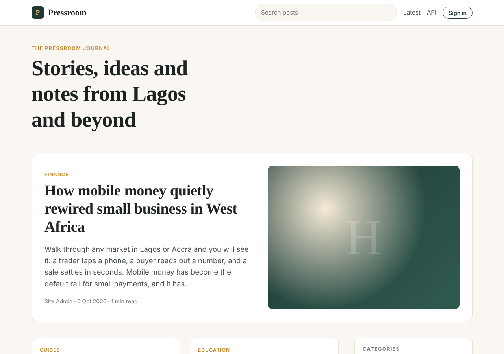
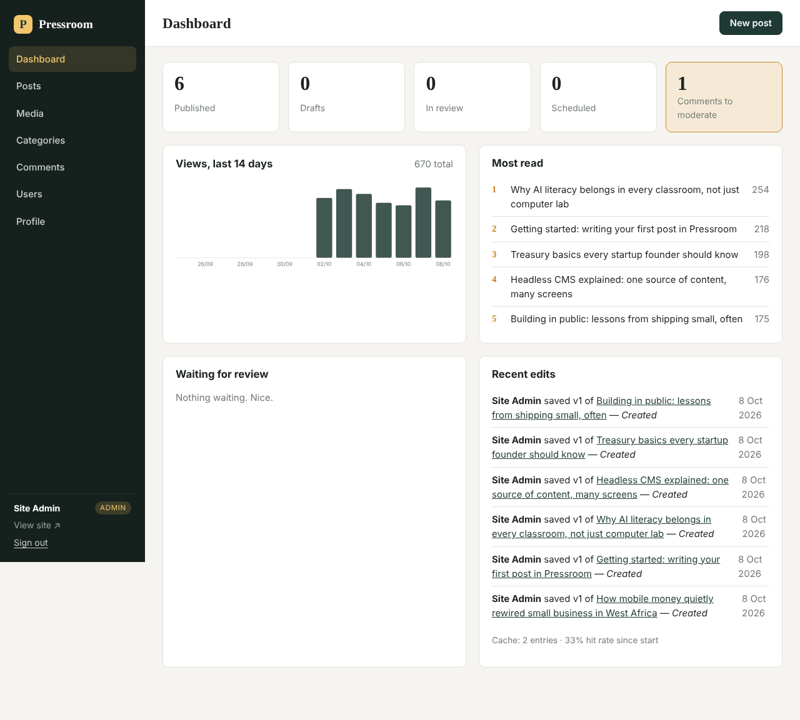
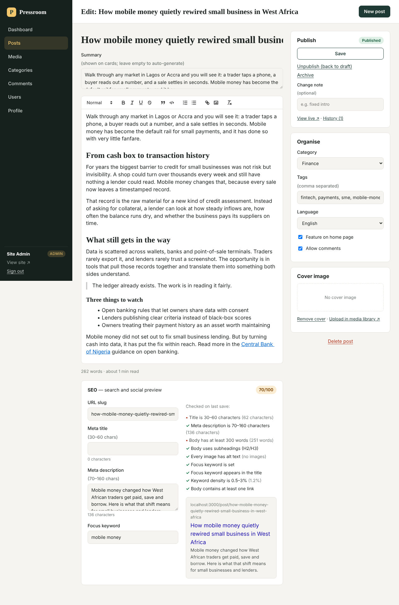

# Pressroom CMS

A content management system for teams that write, review and publish together. Built with **Node.js, Express and MongoDB**, server-rendered for speed and SEO, with a read-only **headless JSON API** for any other front end.

**Live app:** _add your Render URL here_ · **Admin:** `/admin`



## Highlights

| Area | What it does |
| --- | --- |
| **Editorial workflow engine** | Posts move through *Draft → In review → Scheduled / Published → Archived*. Each transition is checked against the user's role, so authors can submit but only editors and admins can publish. |
| **Version history & rollback** | Every save stores a full snapshot. Browse any version and restore it in one click; the restore itself becomes a new version, so nothing is ever lost. |
| **Content scheduling** | Pick a date and time (in your own time zone); a background job publishes the post when it's due, and the public site also respects the time immediately. |
| **SEO analyser** | Scores each post out of 100 on nine checks (title and description length, word count, headings, image alt text, focus keyword placement and density, links) and shows a live search-result preview. |
| **Content recommendations** | "Read next" ranks other posts by shared tags, category, language and freshness. |
| **Headless API** | `GET /api/posts`, `/api/posts/:slug`, `/api/categories` with pagination and filters, CORS enabled. |
| **Analytics dashboard** | Per-day page views, most-read posts, review queue, recent edits and cache hit rate. |
| **Media library** | Uploads are stored in MongoDB (safe on hosts with temporary disks), checked by file signature, and served with long cache headers. |
| **Comments** | Visitor comments are held for moderation, with a honeypot and rate limit against spam. |
| **PWA & discovery** | Offline-capable service worker, web manifest, `sitemap.xml`, `robots.txt`, RSS feed, Open Graph and Twitter tags. |
| **Multi-language content** | Each post carries a language (English, French, Yoruba, Hausa, Igbo) used in the page `lang` attribute and API filters. |

## Screenshots

| Dashboard | Editor with SEO score |
| --- | --- |
|  |  |

## Security

- Passwords hashed with bcrypt (12 rounds); session regenerated on login to prevent fixation.
- CSRF protection on every form (per-session synchronizer token, constant-time comparison).
- XSS protection: rich text sanitised with an allow-list on save; EJS escapes everything else; strict Content-Security-Policy via Helmet.
- NoSQL injection guard strips `$` operators from input; search input is regex-escaped.
- Rate limits on login, comments and the API. Upload type is verified from the file's bytes, not its name.
- Role-based access control: **admin**, **editor**, **author** (matrix shown on the Users page).

## Tech stack

Node.js 22 · Express 5 · MongoDB + Mongoose 9 · EJS · Quill 2 editor (self-hosted) · Helmet · express-session + connect-mongo · Node test runner + Supertest · GitHub Actions · Render

See [docs/ARCHITECTURE.md](docs/ARCHITECTURE.md) for the design and [docs/USER_GUIDE.md](docs/USER_GUIDE.md) for how to use it.

## Run locally

You need Node.js 22.12+ and a MongoDB database (local, Docker, or a free MongoDB Atlas cluster).

```bash
git clone https://github.com/ADAGBON/cms-project.git
cd cms-project
npm install
cp .env.example .env        # then edit MONGODB_URI, ADMIN_EMAIL, ADMIN_PASSWORD
npm run dev                 # http://localhost:3000
```

On first start with an empty database, the app creates the admin account from `ADMIN_EMAIL` / `ADMIN_PASSWORD` plus sample categories, posts and analytics. If those variables aren't set, open `/admin/setup` to create the first admin.

## Tests

```bash
npm test         # 39 tests: unit + full HTTP flows against a real database
npm run coverage # ~88% line coverage
```

Tests use `TEST_MONGODB_URI` (default `mongodb://127.0.0.1:27017/pressroom_test`) and drop that database when done. CI runs them on every push against MongoDB 7, then boots the production server and checks it serves seeded content.

## Deploy (Render + MongoDB Atlas)

1. **Database:** create a free cluster on [MongoDB Atlas](https://www.mongodb.com/cloud/atlas). Add a database user, and under *Network Access* allow `0.0.0.0/0` (Render's free tier has no fixed IP). Copy the connection string and add a database name, e.g. `.../pressroom?retryWrites=true&w=majority`.
2. **App:** on [Render](https://render.com) choose **New → Blueprint**, pick this repo, and fill in `MONGODB_URI`, `ADMIN_EMAIL` and `ADMIN_PASSWORD` when asked. `SESSION_SECRET` is generated for you.
3. Open the URL Render gives you. The first boot seeds sample content; sign in at `/admin`.

Free Render services sleep after inactivity, so the first request after a pause can take up to a minute.

## Project structure

```
server.js              entry point: DB connect, seed, scheduler, HTTP server
src/app.js             Express app: security middleware, sessions, routes
src/config/            environment config and DB connection
src/models/            User, Post, Revision, Category, Comment, Media, PageView
src/services/          workflow, posts (save/version/schedule), seo, recommend, cache
src/middleware/        auth (roles), security (CSRF, input sanitising, flash)
src/routes/            public site, admin, headless API
src/views/             EJS templates (public + admin)
public/                CSS, JS (editor, admin, service worker), icons
tests/                 unit and integration tests
```

## License

MIT
